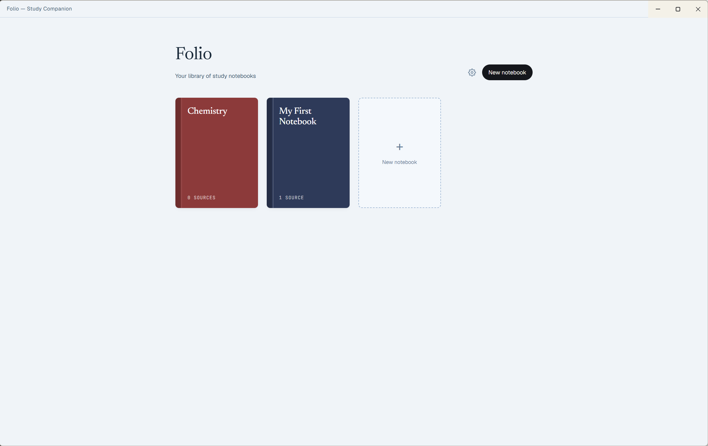
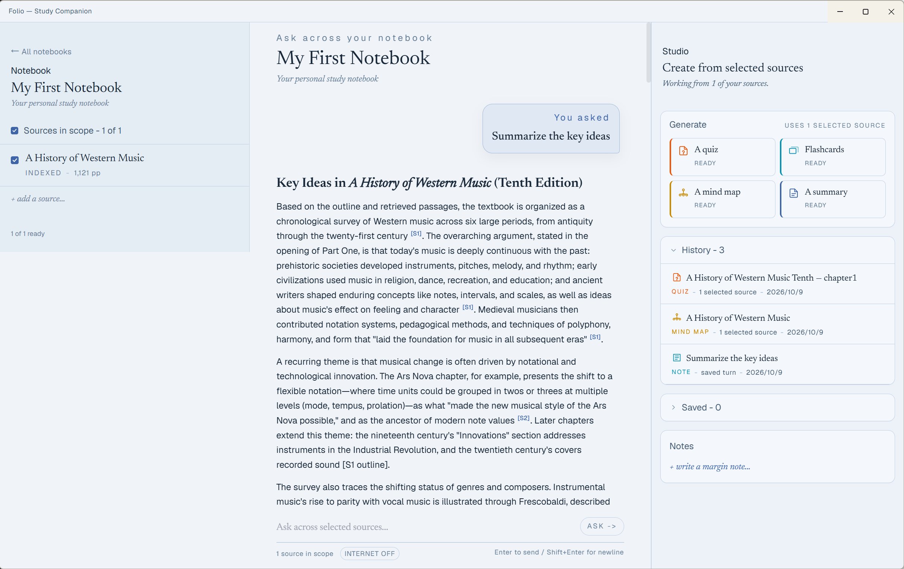
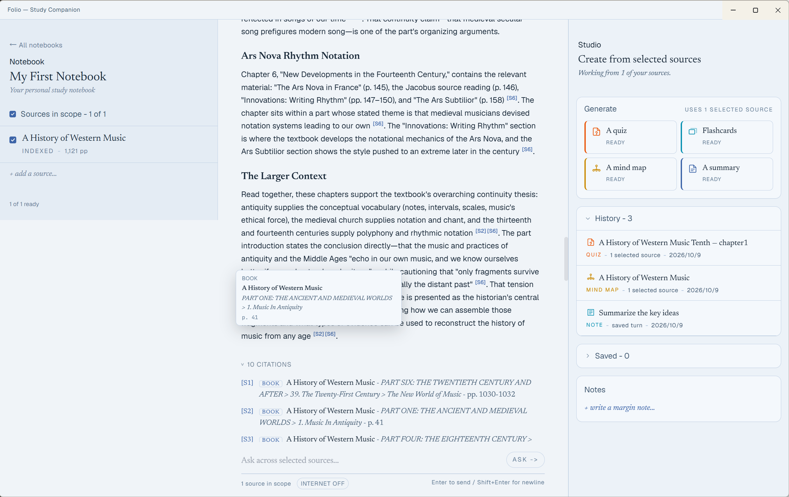

# Folio

> A local-first study companion — turn your textbooks, papers, and notes into a
> private, citation-backed question-answering workspace.


*Your notebooks, shown as a bookshelf*


*Ask questions against an ingested book*


*Answers cite the exact chapter and section they came from*

---

## What Folio does

Ask your books questions — *"explain binary search"*, *"what does Chapter 3 cover?"*,
*"compare X and Y"* — and get an answer that cites the exact chapter, section, and
page it came from, so you can verify it yourself.

- **Reads the formats you study from.** PDF, EPUB, PPTX, DOCX, Markdown, and TXT,
  batched into one library.
- **Understands structure, not just keywords.** It indexes each book's table of
  contents, so answers land in the right chapter and you can browse any book's outline.
- **Generates study materials.** Summaries, flashcards, quizzes, and mindmaps from
  anything you've added.
- **Private by default.** Your files, the search index, and your answers stay on
  your computer. If you enable a cloud model, only the question and the book
  excerpts needed to answer it are sent to that provider. No Folio account is
  required.

## Install

Folio is currently available through two installation paths.

### Run from source in your browser — recommended

This is the recommended route while the Windows preview is unsigned. You need
**Git** and **Python 3.10 x64**. First-time setup and first use require internet
access to install Python dependencies and download the local BGE embedding model
and tiktoken tokenizer cache. Node.js is not required unless you change and
rebuild the frontend.

```powershell
git clone https://github.com/XL9610/Folio.git
cd Folio
py -3.10 -m venv .venv
.\.venv\Scripts\python.exe -m pip install -r backend\requirements.txt -r backend\requirements-extractors.txt
```

Start the backend in one PowerShell window:

```powershell
cd backend
..\.venv\Scripts\python.exe -m uvicorn app.main:app --host 127.0.0.1 --port 8000
```

From the repository root, start the committed frontend in a second window:

```powershell
.\.venv\Scripts\python.exe -m http.server 5500 --bind 127.0.0.1 --directory frontend
```

Open [http://127.0.0.1:5500](http://127.0.0.1:5500). This route does not
disable or bypass Windows security controls; managed-device policies can still
block Python or native dependencies.

### Unsigned Windows preview — test machines only

Download `Folio Setup 0.2.1.exe` from the
[latest GitHub Release](https://github.com/XL9610/Folio/releases/latest). Before
running it, compare its SHA-256 with the value published in the release notes:

```powershell
Get-FileHash '.\Folio Setup 0.2.1.exe' -Algorithm SHA256
```

The preview is not code-signed. Microsoft Defender SmartScreen may warn, and
Smart App Control may block it without offering a per-app exception. If that
happens, use the source route above. On a dedicated test machine, you may instead
choose to disable Smart App Control globally under
**Windows Security > App & browser control > Smart App Control settings**, but
that reduces system-wide protection; read
[Microsoft's guidance](https://support.microsoft.com/en-gb/windows/security/threat-malware-protection/smart-app-control-frequently-asked-questions)
first and do not weaken a primary machine solely to run Folio.

The installer bundles the desktop runtime, backend, embedding model, and
tokenizer cache, so ingestion and retrieval require neither Python nor Node.js
and can run offline. Generative answers still require a configured cloud model
or a locally installed model server.

## AI answers (optional)

Search and retrieval work out of the box with no setup. To get full conversational
answers and generate study materials, connect a language model in **Settings** —
OpenAI, Anthropic, Google, DeepSeek, or a local model (Ollama). Your API key is
stored only in your local configuration.

## How it works

1. **Add a book** — drop in a file; Folio reads its text *and* its structure.
2. **Ask** — your question searches by meaning and by structure.
3. **Verify** — every answer comes with citations pointing back to the source.

## Tech stack

Folio keeps document extraction, embeddings, retrieval, and storage local. The
generative-model layer is optional and can use either a cloud provider or a
locally running model server.

| Layer | Technologies |
| --- | --- |
| Desktop | Electron 44, Electron Builder, NSIS |
| Frontend | React 18 with JavaScript/JSX, Tailwind CSS 3, esbuild, PostCSS, Autoprefixer, marked, DOMPurify |
| Backend API | Python 3.10, FastAPI, Uvicorn, Pydantic 2 |
| RAG and retrieval | Structure-aware chunking, tiktoken token budgeting, Sentence Transformers with `BAAI/bge-small-en-v1.5`, sqlite-vec dense search, SQLite FTS5 keyword search, reciprocal rank fusion (RRF), and optional LLM reranking |
| Local storage | SQLite in WAL mode for notebooks, documents, chunks, jobs, conversations, and generated artifacts; local extraction-artifact storage |
| Document parsing | PyMuPDF, EbookLib, python-pptx, python-docx, Kreuzberg, Trafilatura |
| Model providers | OpenAI-compatible APIs (including OpenAI, DeepSeek, Ollama, and LM Studio), Anthropic, and Google Gemini |
| Packaging and quality | PyInstaller, pytest, Playwright, frontend build-drift checks, and packaged-backend smoke tests |

SQLite FTS5 is the built-in keyword backend; BM25x can be used when installed.
The Windows installer bundles the Python backend, local embedding model, and
tokenizer data, but not a generative LLM.

## Evaluation

Folio is evaluated with a RAGAS benchmark over a 61-question set spanning 21
documents (textbooks, papers, novels, a slide deck, and a magazine issue) plus
deliberately unanswerable prompts. Answers are generated by DeepSeek
`deepseek-chat`; the judge is OpenAI `gpt-4o`.

| Metric | Score |
| --- | --- |
| Faithfulness — answers stay grounded in retrieved text | 0.968 |
| Answer relevancy | 0.859 |
| Context precision — retrieved chunks are on-topic | 0.903 |

All 6 deliberately unanswerable questions were correctly refused (100%).

These numbers carry the usual LLM-judge caveats: the judge can be lenient or
inconsistent, and the reference-based metrics cover only a small subset. The run
also surfaced real weaknesses — a ~3.6% false-refusal rate on answerable
questions, weaker retrieval and synthesis on unstructured documents (magazines,
slide decks, fiction), and judge mis-scoring of non-English answers.

---

## Developing

Folio is a FastAPI backend + React frontend, packaged as an Electron desktop app
(the backend ships as a PyInstaller binary).

The browser route above uses the committed `frontend/index.html` and
`frontend/dist/` artifacts. Node.js 22.12 or newer is needed only when modifying
or rebuilding the frontend:

```powershell
npm install
npm run build
npm run build:check
```

### Build the installer

One script runs the whole pipeline — frontend, embedding-model and tiktoken-cache
fetch, PyInstaller, installer — and refuses to package a `.env`:

```powershell
powershell -ExecutionPolicy Bypass -File scripts/build-desktop.ps1 `
  -PythonExe "C:/path/to/cpu-torch-venv/Scripts/python.exe"
```

Output: `release/Folio Setup <version>.exe`.

### Tests

```powershell
.\.venv\Scripts\python.exe -m pip install -r backend\requirements-dev.txt
.\.venv\Scripts\python.exe -m pytest -q
```

## Known limitations

- **No bundled generative model.** Ingestion and search are fully offline, but
  conversational answers and Studio (summary/flashcards/quiz/mindmap) require a
  cloud model or a locally-installed Ollama/LM Studio server.
- **English-first retrieval.** The Chinese answer option changes the output
  language, not the underlying retrieval, which is tuned for English text.
- **Mind Map is single-source**, and long-document Summary/Mind Map use
  representative sampling rather than exhaustive coverage.
- **Source-scope cap.** When a question selects many sources, the planner uses
  only the first five by default.
- **Text-focused.** Scanned pages, images, charts, and handwriting are not
  guaranteed to be understood. The single-file limit is 50 MB.
- **Local-only data.** There is no sync, export, or restore flow. API keys are
  stored in a local plaintext `.env` file.
- **Desktop installer: Windows only, unsigned, and without auto-update.** It may
  be warned on or blocked by Windows security controls; use the browser route
  instead of weakening protections on a primary machine.
- **Citations carry excerpts** that the UI does not surface yet; the underlying
  snippet data is already present and ready to display.

## License

MIT. See [THIRD_PARTY_NOTICES.txt](THIRD_PARTY_NOTICES.txt) for bundled
third-party components and fonts.
